# M002.A3.1 — comparação Classic / Slim

Capturas reais, mesmos cenários e fases. Aprovação estética pendente. O comparador completo fica em `../SKIN_COMPARISON.html`.

| Cenário / fase QA | Classic | Slim |
|---|---|---|
| sword / 1.70 s | 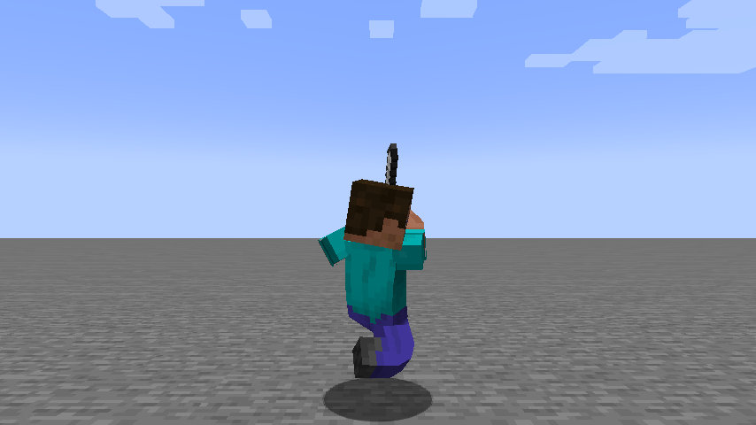 | 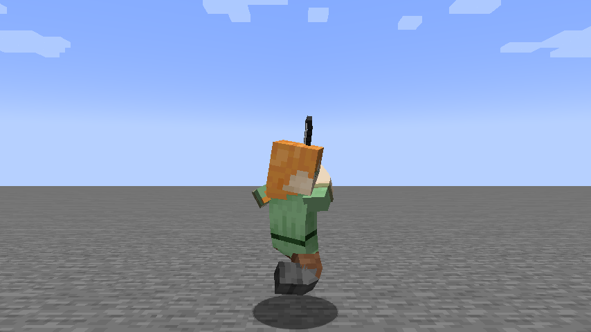 |
| roll / 1.90 s | 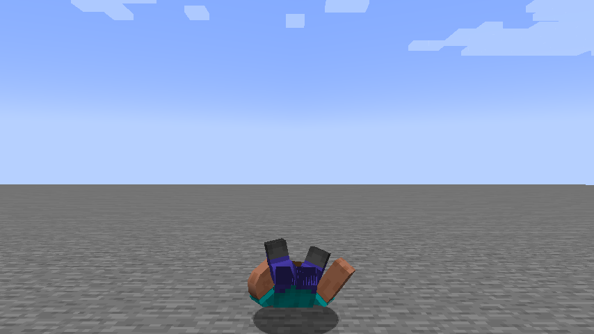 | 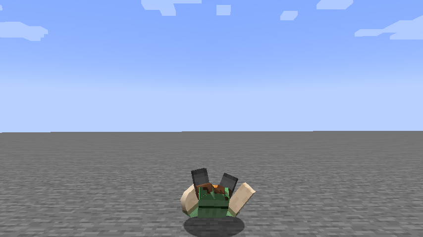 |
| bow_shot / 2.50 s | 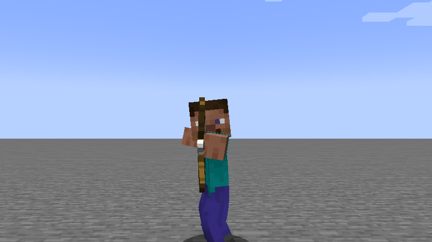 | 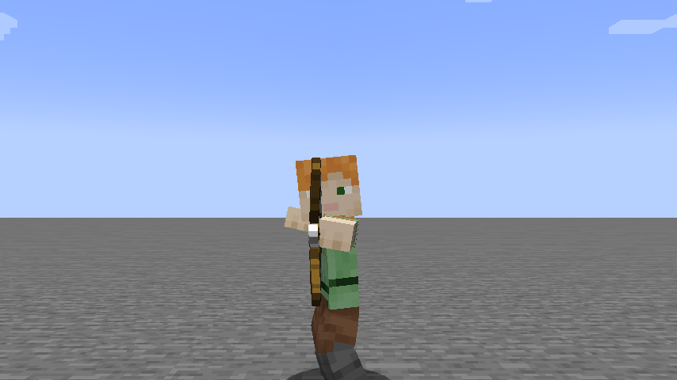 |
| consume / 2.10 s | 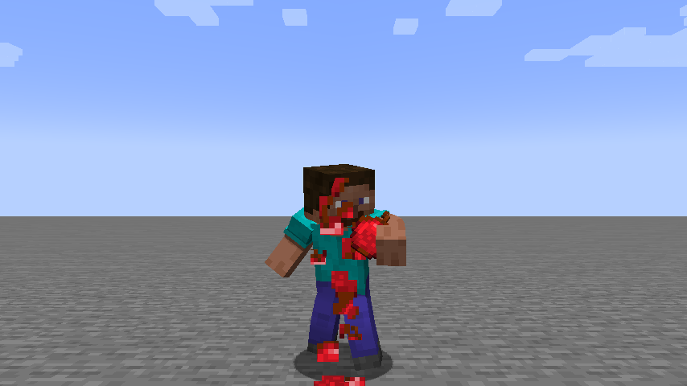 | 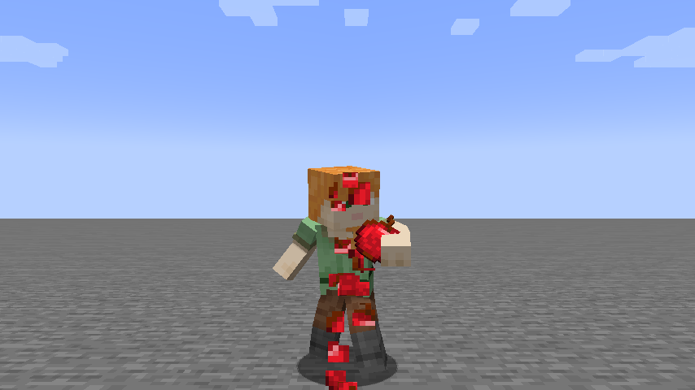 |
| torch / 2.00 s | 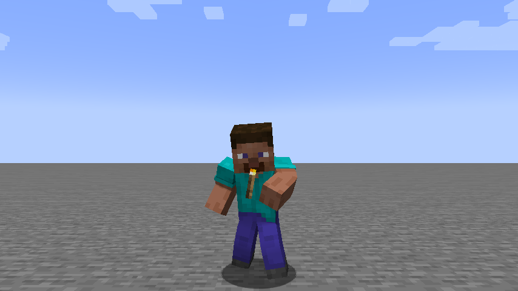 | 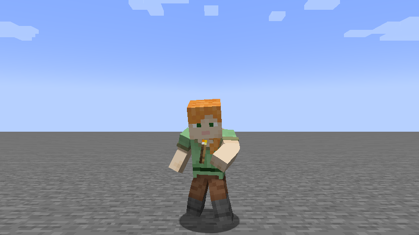 |
| crouch_move / 2.00 s | 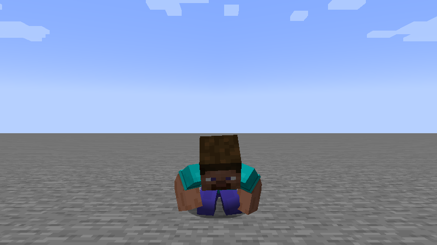 | 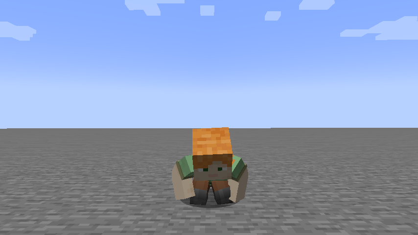 |
| jump / 1.40 s | 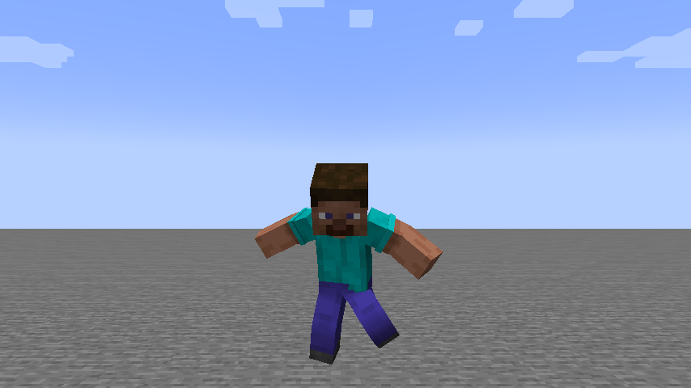 | 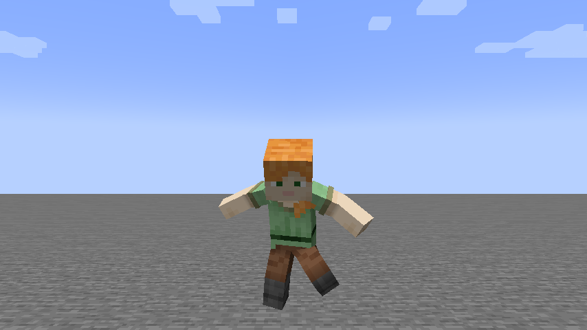 |

Este pacote mostra uma seleção de quadros, não mede desempenho nem certifica todos os resource packs, skins ou multiplayer. O JAR final e as verificações estão no relatório técnico do marco.
