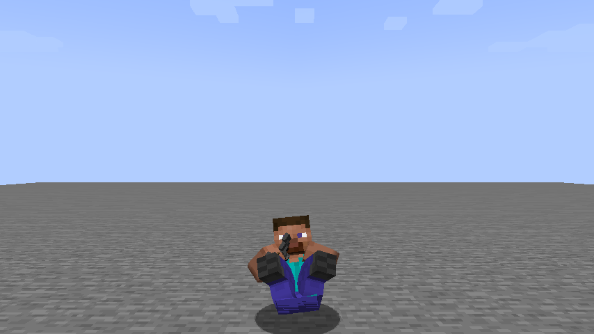
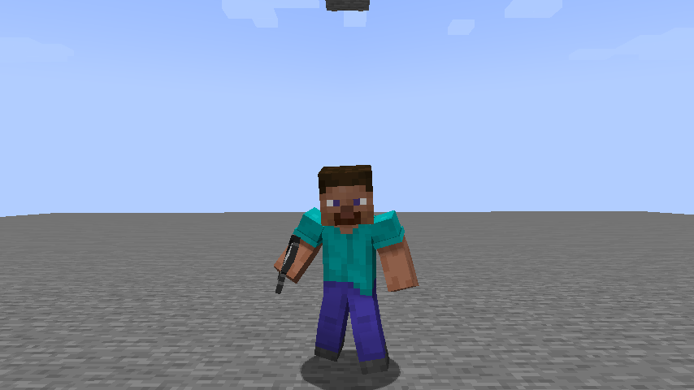
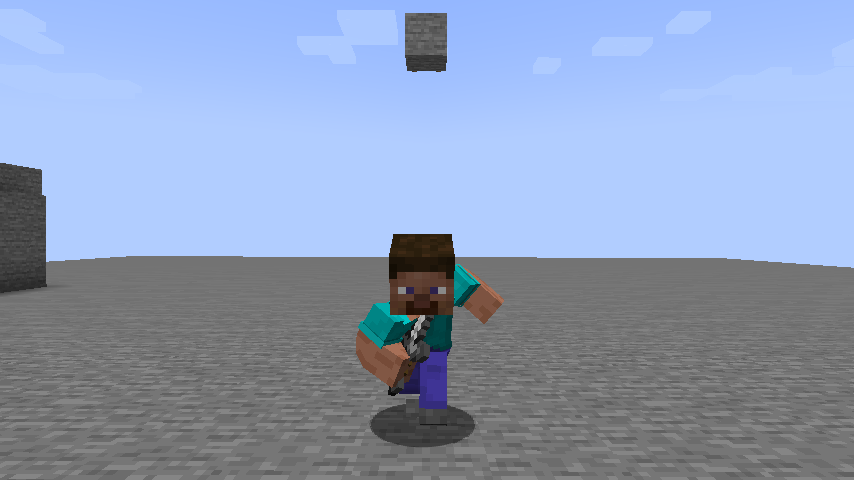
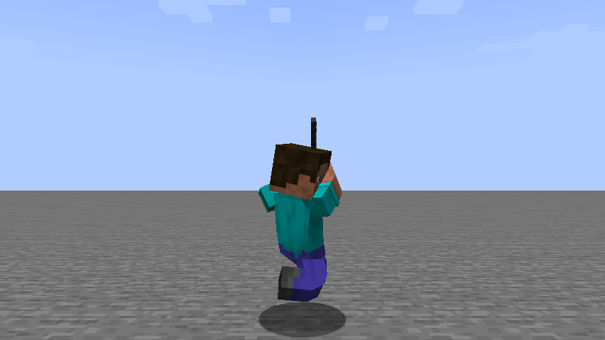
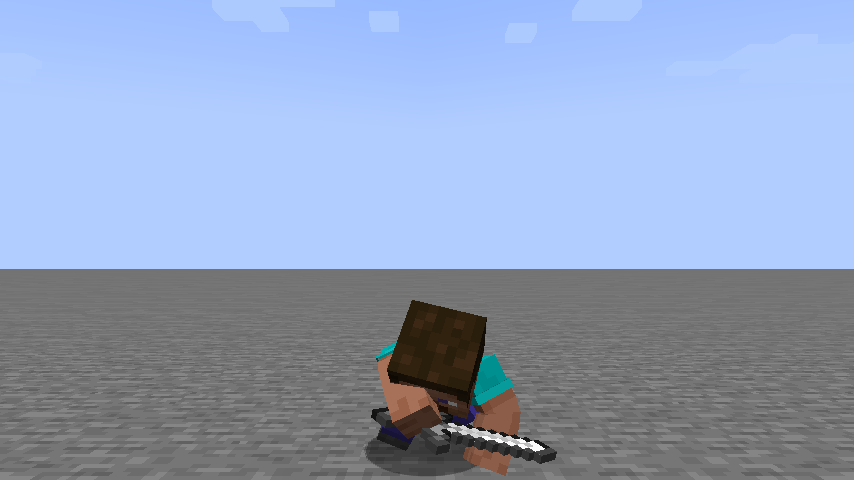
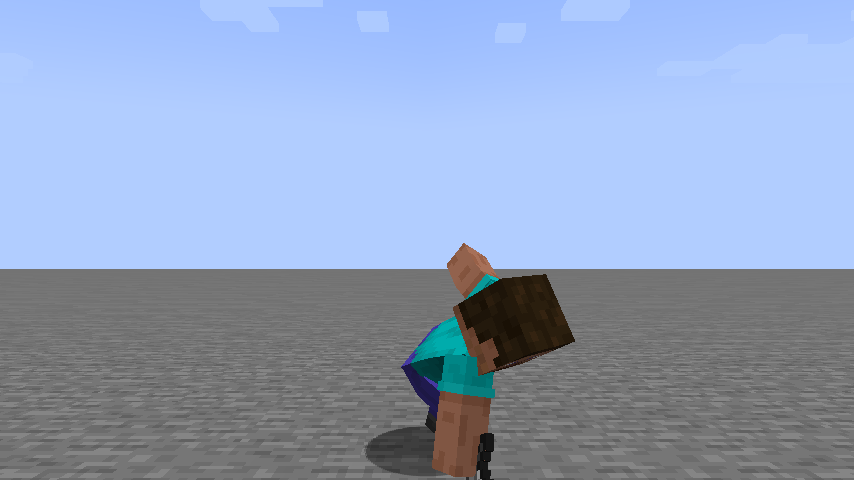
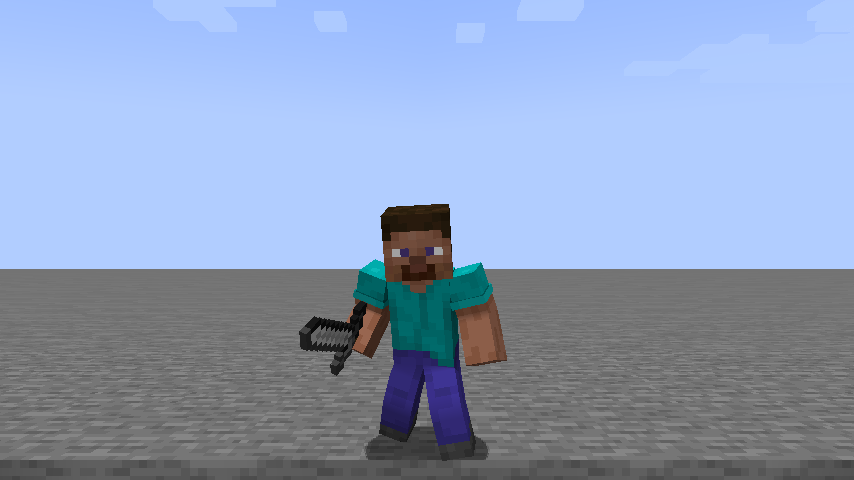
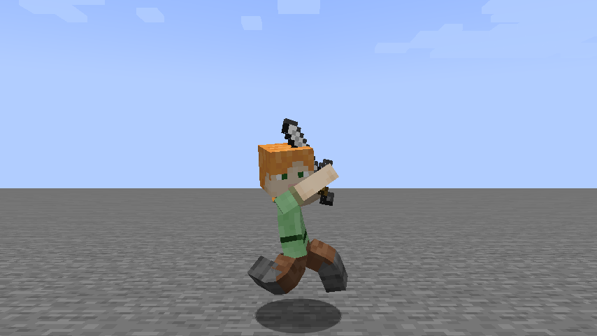

# M002.A3.2 — capturas reais

Quadros de QA no mundo normal. Tempos relativos à entrada de ação no cenário; não são vídeo contínuo nem aprovação estética.

## roll_sprint-38

## roll_sprint-45

## roll_sprint-52

## A-38

## combo-45

## heavy-52

## edge-52

## slim-38

