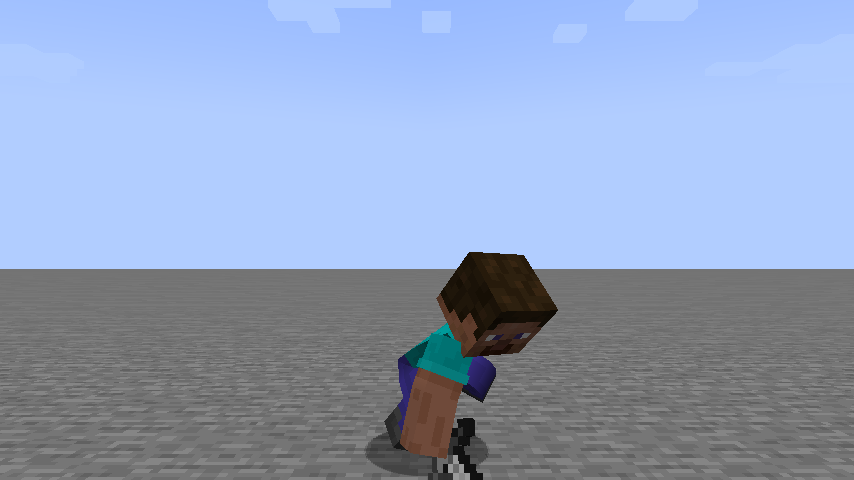
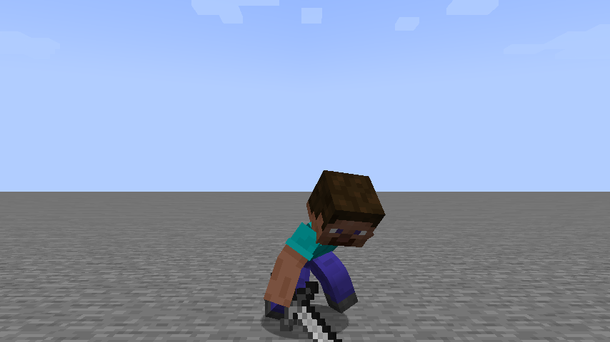
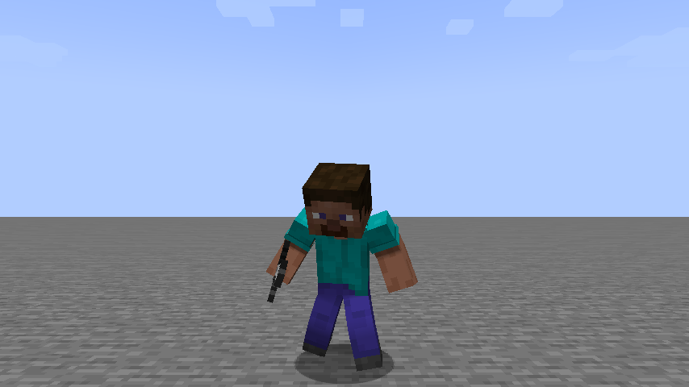
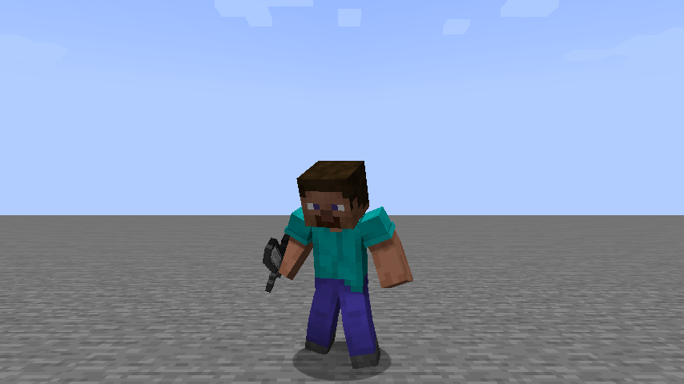
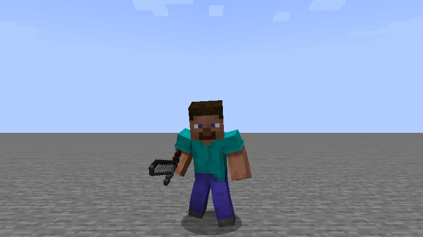
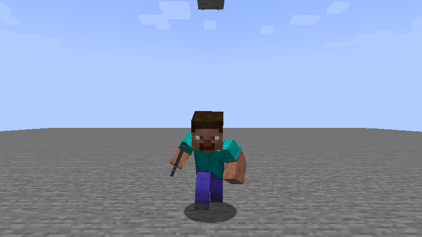
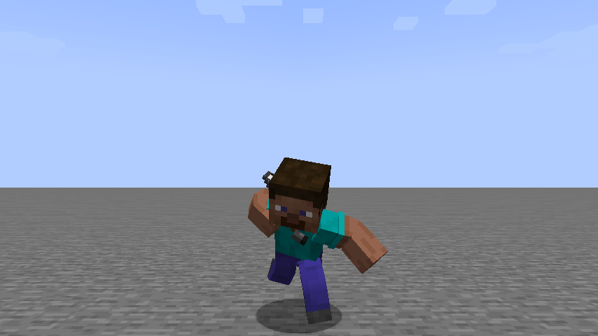
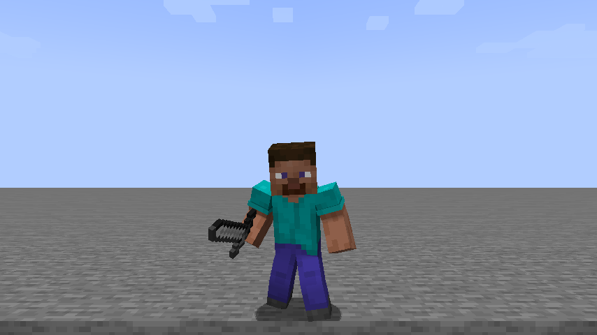
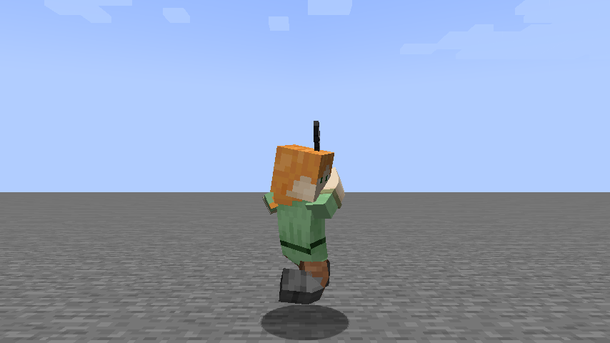

# M002.A3.3 — seleção de capturas reais

Capturas do cliente Forge durante ações autorizadas no servidor integrado. Ângulo frontal; a câmera acompanha o jogador. Não é vídeo contínuo, nem comparação de performance. Fase 30 é a entrada do pedido; autorização chega após transporte local. As fases seguintes são ticks de cliente a 20 Hz.

O trecho pesado 60–70 cobre o fim do giro, recuperação acelerada e retorno a Idle. O tempo do clipe é remapeado; os números de fase não são quadros da animação fonte. Avaliação estética permanece com o usuário.

## heavy-60

## heavy-62

## heavy-64

## heavy-66

## heavy-70

## heavy_sprint-70

## combo-64

## edge-60

## slim-38

