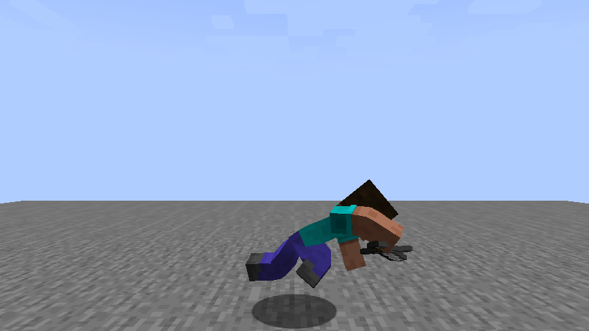

# M002.A1.1 — QA visual e material comparativo

**Status: tecnicamente testável, sem aprovação estética automática.** Este marco preserva as animações e o R3; registra os problemas encontrados para decisão do usuário.

## Visualizador local

Abra [VIEWER.html](../animation_pipeline/reports/m002_a1_1/VIEWER.html) no navegador. Não precisa de servidor HTTP, internet ou instalação. Há dois painéis independentes para selecionar movimento/ângulo, reprodução 1×, 0,5×, 0,25× e 0,1×, pausa, avanço por quadro e marcas de troca de clipe/impacto do servidor.

Foram capturadas **24 sequências, 2.184 PNGs**, com 91 amostras por sequência a 20 Hz nominais: oito cenários em ângulos frontal, lateral e traseiro. Cada trecho cobre 4,5 segundos. A pasta de PNGs ocupa aproximadamente 147 MiB. Para compartilhar o visualizador, mantenha `VIEWER.html` e `screenshots/` juntos.

Os cenários são combo até Idle, combo até Jog, pesado, pausa/reinício A, e cancelamentos de A/B/C/pesado por Roll. A câmera orbita somente durante renderização da fixture de QA; direção do jogador, KeyMappings, rede, física e clipes continuam reais. Não são renders Blender ou poses inventadas. Não havia FFmpeg disponível e nenhuma ferramenta foi instalada para gravar vídeo.

1× reproduz as amostras no tempo nominal capturado, sem interpolação artificial. Não é vídeo contínuo de GPU: eventos entre dois ticks podem não aparecer, e a imagem disponível no tick pode pertencer ao último frame renderizado. As três vistas são execuções separadas do mesmo roteiro; pequenas diferenças de fase podem ocorrer. O clipe e seu tempo aparecem em cada painel.

[Quadros críticos antes/depois](../animation_pipeline/reports/m002_a1_1/CRITICAL_FRAMES.md), [telemetria do visualizador](../animation_pipeline/reports/m002_a1_1/VIEWER_TIMELINE.json) e [prévia dos painéis](../animation_pipeline/reports/m002_a1_1/VIEWER_PREVIEW.png).

## Leves e transições

| Aspecto | Evidência técnica/visual | Avaliação |
|---|---|---|
| Idle → A | Diferença máxima de orientação global dos ossos de aproximadamente 3,4° entre poses de referência. | Pequena descontinuidade de referência; percepção final depende da reprodução. |
| A → B | Aproximadamente 15,9° no braço direito; ambos entram uma vez, sem reinícios por tick. | Corte a revisar, especialmente em câmera lenta. |
| B → C | Aproximadamente 7,1° na perna direita. | Referências próximas; ainda há troca direta de clipe. |
| C → Idle | Aproximadamente 4,4° na pelve; retorno observado nas três vistas. | Recuperação funcional, sem ação presa. |
| C → Jog | Até 114,3° no antebraço direito, entre endpoint de C e início de Jog. | Mudança importante de pose; prioridade de revisão estética. |
| Pausa | Próximo golpe volta a A após o intervalo. | Funcionamento técnico confirmado. |
| Cancelamentos | A/B/C cancelam e Roll termina; tentativas futuras de impacto não acontecem. | Há **um quadro de Idle, cerca de 50 ms**, antes do Roll nas 12 sequências de cancelamento. Pode aparecer como estalo. |

Os ângulos são comparações de orientação global de ossos no GLB, não deslocamentos da lâmina ou limites de aceitação estética. `TRANSITION_ANALYSIS.json` também registra ângulos locais, que podem diferir devido à compensação pela hierarquia; não devem ser confundidos com giro visual global.

Há separação aparente dos pés do solo, especialmente em B e em partes de C. Na amostragem LBS do GLB, o menor Y dos vértices das pernas em B ficou entre **0,179 e 0,245 bloco** acima do plano de referência. C atingiu cerca de **0,232 bloco**. Esse diagnóstico considera as pernas e a camada externa, não resolve contato físico nem determina se uma elevação era intencional na fonte. Os ataques continuam sem deslocamento físico próprio; os passos visuais podem parecer deslizamento. Nenhuma correção de root motion ou contato dos pés foi aplicada.

Nos quadros amostrados a espada continua acompanhando mão/punho, sem uma segunda espada vanilla evidente. Os anchors e UVs permaneceram idênticos. Isso não elimina a possibilidade de interseções pontuais entre arma, braços e tronco; a revisão completa no visualizador permanece necessária. A flexão do tronco é a do R3 aprovado, aplicada aos clipes novos.

As durações originais foram mantidas. A/B são movimentos curtos de 0,433/0,533 s; não foram acelerados neste marco. Ausência de reinício de clipe é uma verificação técnica, não uma garantia de ausência de tremor perceptível ou de movimento artificial.

## Pesado

Permanece o recorte **60–130** de `Sword_Heavy_Combo`, com 2,333 s e impacto no tick 12 / 600 ms. O endpoint original foi preservado; a recuperação completa aparece antes do retorno a Idle. Não houve novo recorte ou criação de poses.

A entrada é o principal ponto de atenção: o trecho começa com corpo inclinado e pernas já preparadas, sem sair de uma postura neutra. A comparação Idle → início do pesado chega a **178,2° no braço esquerdo** e aproximadamente **0,96 bloco de diferença no pivô desse osso**. São diferenças entre poses no rig, sem deslocamento físico da entidade. Isso sustenta o risco de snapping visto na mudança de silhueta.

Ao final, a maior diferença para Idle de referência é aproximadamente **22,3° na cabeça**. Portanto o recorte termina com a recuperação original, mas a transição direta não equivale a uma conexão perfeitamente contínua. O giro, o tempo de preparação, a leitura do impacto e a recuperação precisam de aprovação em 1×. Cancelar pelo Roll apresenta o mesmo quadro intermediário de Idle observado nos leves.

## Recomendação

Manter a ativação AUTO entregue e separar sua aprovação técnica da estética. Priorizar na revisão humana: entrada do pesado, C → Jog, quadro intermediário nos cancelamentos e contato dos pés em B/C. Eventual interpolação entre estados ou revisão do retargeting exige decisão posterior; **nenhuma dessas alterações foi executada aqui**. Não há recomendação de remodelar o personagem ou substituir o R3.

O visualizador foi testado no Edge existente: imagens locais, seleção de movimento/ângulo, marcas, avanço de um quadro e reprodução 1×/0,25× funcionaram sem exceções JavaScript. Isso comprova o material de comparação; a aprovação de fluidez e aparência continua reservada ao usuário.
