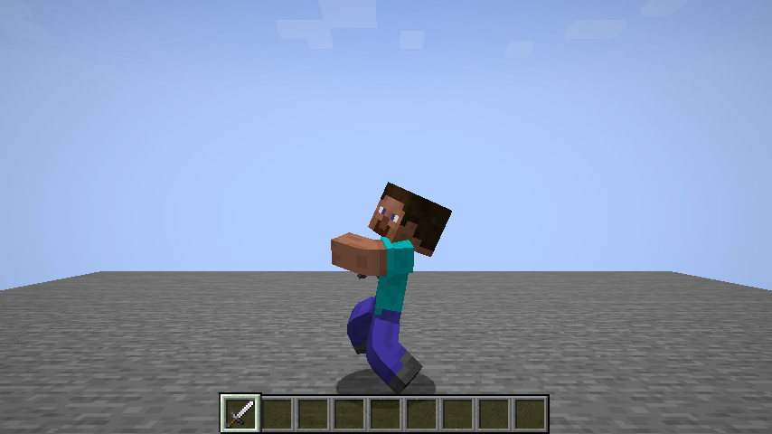
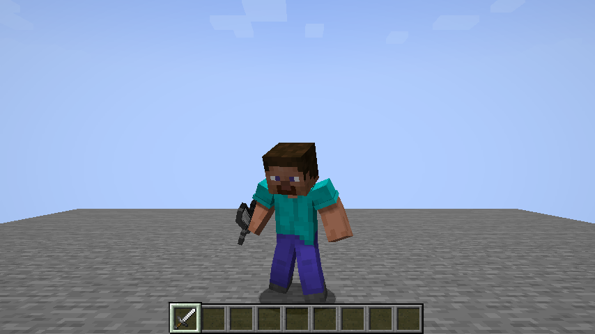

# M002.A1 — Inspeção e ataque pesado derivado

## Fonte e inspeção

UAL2 `Sword_Heavy_Combo`, 4,333 s, 131 amostras a 30 Hz. Fonte de trabalho `animation_pipeline/input/UAL2/UAL2_Standard.glb`; SHA-256 `8cee20ab1bc55130092447e810e26df22dd2803eccc54f52137a7d54d7ab88a8`. O GLB original não foi alterado. Nenhum código, modelo ou movimento de outro mod foi importado.

Foram geradas poses Blender do clipe completo a cada dez quadros, em `animation_pipeline/reports/m002_a1/heavy_*.png`. Elas documentam postura, sem skin/espada, e **não são capturas do Minecraft**. A sequência apresenta movimentos encadeados, giro do corpo, elevação dos braços e recuperação final. Portanto não foi tratada como um ataque único de 4,333 s.

## Recorte inicial rejeitado

Foi experimentado o intervalo 0–24 (0,8 s). Testes de controle/dano passaram, mas as capturas reais em `rejected-first-cut/` mostram que o trecho acaba durante a rotação, com o corpo de costas e sem recuperação neutra. Foi rejeitado visualmente. Seus 81 checks estão preservados em `INITIAL_CANDIDATE_RUNTIME.json` e não são apresentados como aprovação do movimento final.

## Variante final em avaliação

Foi selecionada a frase final, **quadros 60–130**, equivalentes a 2,000–4,333 s da fonte. A variante tem 2,333 s, conserva as 71 poses originais, o windup com braços elevados, a passagem descendente e a recuperação original para postura neutra. Não há aceleração, keyframes genéricos, combo pesado completo ou carregamento por botão mantido.

- Início da variante: quadro 60 da fonte.
- Windup: início até aproximadamente 0,6 s da variante.
- Impacto servidor: tick 12 / 0,6 s, quadro 78 da fonte, na passagem descendente.
- Recuperação: até 2,333 s; próximo ataque após 47 ticks.
- Dano bruto provisório: `heavyDamage = 6.0`, antes de armadura/resistência/imunidade vanilla.

O corte começa em postura inclinada/agachada herdada da fonte. A entrada a partir de Idle é uma limitação a avaliar visualmente; não foi inventada uma animação de preparação adicional. Os testes verificam reprodução única, punho/espada acompanhando o rig, retorno à locomoção, dano e cancelamento por Roll. Capturas reais finais: `screenshots/heavy-phase-0.png` até `heavy-phase-8.png`, em intervalos aproximados de 0,292 s, e `screenshots/heavy-active.png` em reprodução normal.

Se a postura inicial ou a leitura do golpe não forem aprovadas pelo usuário, esta variante pode ser desabilitada sem alterar os leves ou a infraestrutura de estados/dano. **A aprovação estética permanece pendente.** A viabilidade técnica é distinta dessa decisão.

Preparação do recorte final no Minecraft:



Recuperação original, com espada ainda presa à mão:



## Reprodução e licenças

```powershell
node animation_pipeline/scripts/prepare-a1.cjs
& 'C:\Program Files\Blender Foundation\Blender 5.2\blender.exe' --background --python animation_pipeline/scripts/blender-a1.py -- $PWD.Path
.\scripts\gradle.ps1 build
```

São usados arquivos privados locais e animações derivadas das fontes UAL já inventariadas. As restrições/licenças de terceiros continuam as registradas no inventário M001.0. Este marco não autoriza publicação de arquivos fonte ou derivados sem verificar os direitos de redistribuição; nenhuma distribuição pública foi realizada.
