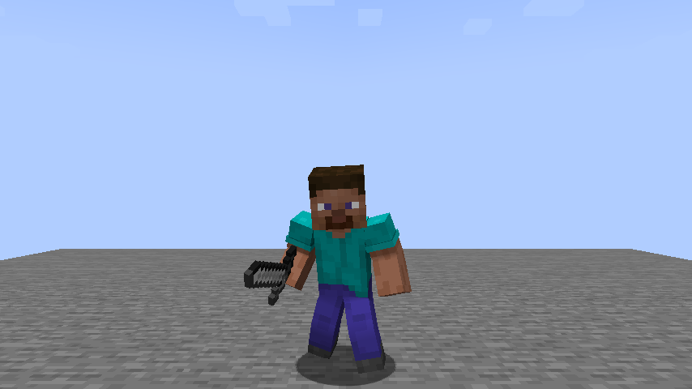
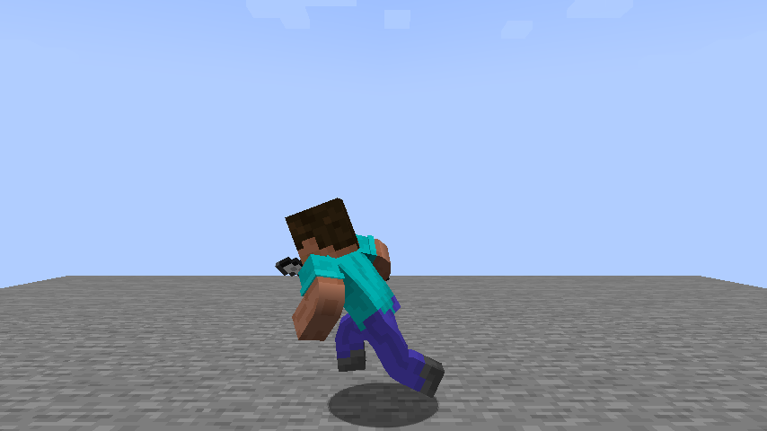
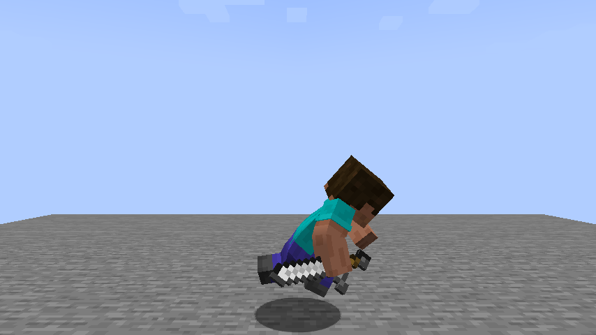
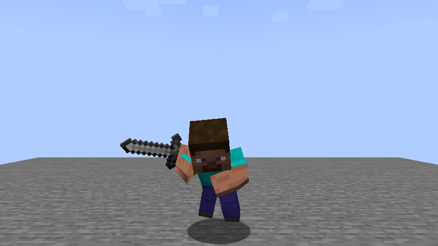
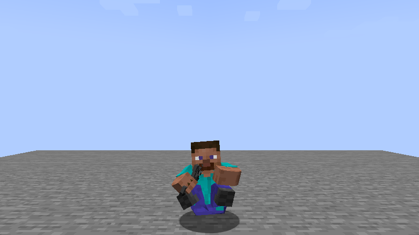
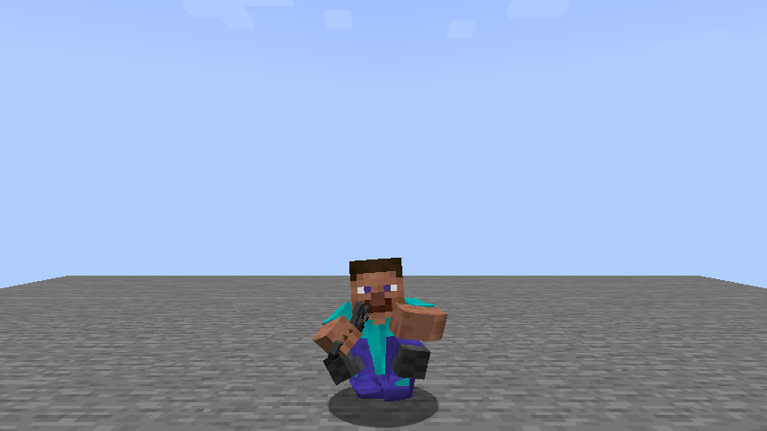
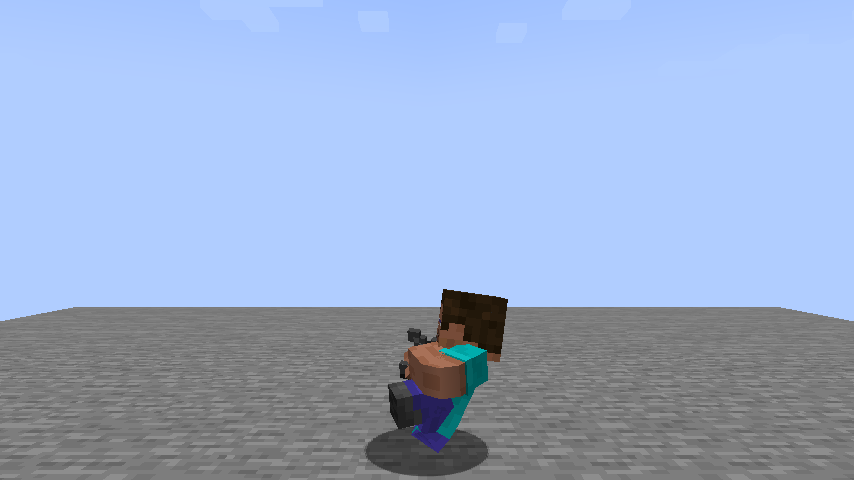
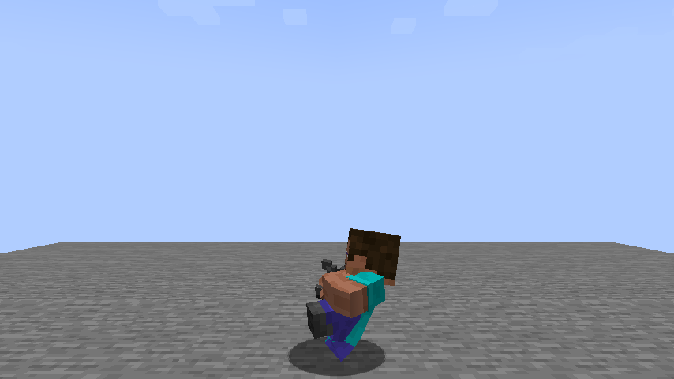
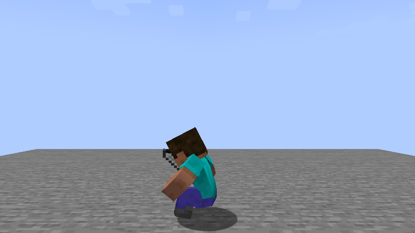

# M002.R3.QA — Validação visual e desempenho

13/11/2026. **Recomendação: manter R3 como referência do laboratório, com R3.1 opcional para revisão estética.** A R3.1 recupera espessura dos cotovelos/joelhos, mas mantém o contato coxa/abdômen e custa mais CPU no Roll. A adoção definitiva não está justificada apenas pelo desempenho deste cenário. Correções pontuais, em uma futura decisão autorizada, parecem mais proporcionais que promover toda a camada atual. Nenhuma correção foi implementada neste QA; CPM permanece padrão.

## Resultados quantitativos

Três repetições por combinação, 10 segundos medidos cada, com ordem alternada. Agregação dos intervalos reais entre frames das três janelas; FPS médio = 1000 / tempo médio. **1% low** = 1000 / média do 1% de intervalos mais lentos (arredondado para cima); não é o inverso do percentil 99 nem a média de FPS instantâneos.

| Animação | Variante | FPS médio | 1% low FPS | Quadro médio ms | Desenho CPU ms/frame | Intervalo GPU ms |
|---|---|---:|---:|---:|---:|---:|
| idle | R3 | 934.7 | 389.9 | 1.070 | 0.427 | 0.220 |
| idle | R3.1 | 935.0 | 386.0 | 1.070 | 0.427 | 0.228 |
| jog | R3 | 931.5 | 391.1 | 1.074 | 0.428 | 0.219 |
| jog | R3.1 | 918.9 | 416.0 | 1.088 | 0.432 | 0.212 |
| sword | R3 | 941.7 | 435.1 | 1.062 | 0.425 | 0.202 |
| sword | R3.1 | 927.6 | 407.9 | 1.078 | 0.430 | 0.212 |
| roll | R3 | 913.8 | 377.6 | 1.094 | 0.434 | 0.203 |
| roll | R3.1 | 719.4 | 333.3 | 1.390 | 0.722 | 0.227 |

No Roll: diferença de **-21.3% no FPS médio**, **+0.296 ms por quadro** e **+0.288 ms no trecho CPU de desenho**. O custo extra médio de quadro corresponde a 1.77% de um orçamento de 16,67 ms; isso não prevê a perda de FPS em um mundo pesado ou em outra resolução. Neste cenário leve há ampla folga para 60 FPS nas duas variantes. O delta de quadro acompanha de perto o delta CPU de desenho, consistente com custo adicional do skinning/morph, sem substituir um profiling completo.

| Alternativa | Avaliação |
|---|---|
| Manter R3 | Recomendado agora como referência: menor custo de Roll, comportamento conhecido; preserva o achatamento já documentado. |
| Adotar R3.1 integralmente | Melhora o volume e é viável a 60 FPS neste cenário, mas cobra custo mensurável e não resolve o contato central. Manter apenas como opção de avaliação até aprovação estética. |
| Correções pontuais | Direção proporcional para uma futura decisão: concentrar o ganho nos cotovelos/joelhos e revisar o contato, buscando menor custo. Nenhuma dessas alterações foi feita neste QA. |

### Repetições e variabilidade

| Animação | Variante | Faixa FPS médio, 3 janelas | Faixa 1% low | GC total ms | JIT total ms |
|---|---|---:|---:|---:|---:|
| idle | R3 | 923–949 | 365–413 | 41 | 422 |
| idle | R3.1 | 927–942 | 378–411 | 8 | 360 |
| jog | R3 | 910–954 | 363–444 | 25 | 462 |
| jog | R3.1 | 907–940 | 403–438 | 8 | 43 |
| sword | R3 | 932–951 | 416–449 | 10 | 335 |
| sword | R3.1 | 910–942 | 392–424 | 4 | 247 |
| roll | R3 | 876–941 | 330–417 | 3 | 451 |
| roll | R3.1 | 716–723 | 318–373 | 30 | 342 |

Idle, Jog e Sword usam o **mesmo GLB R3** nas duas variantes. Diferenças nesses controles são variação do ensaio, não ganho da malha R3.1. O 1% low é sensível a pausas do processo e ao desktop; não se atribui cada diferença à malha. A interpretação principal combina repetição, custo CPU e comportamento dos controles.

## Condições e instrumentação

- Windows 11; Intel Core i5-10400F @ 2,90 GHz, 12 processadores lógicos; NVIDIA GeForce GTX 1050 Ti/PCIe/SSE2.
- OpenGL 4.6.0 NVIDIA 582.28; Java 17.0.20.1; Minecraft 1.20.1, Forge 47.4.28, Polymesh 1.0.0 e CPM já existentes.
- Resolução real 854×480; render/simulação 5/5 chunks; gráficos fancy; mesmas opções de nuvens, partículas, FOV, skin e espada. VSync desligado; opção de FPS 260, que corresponde ao modo sem limitação efetiva neste cliente. FPS são quadros produzidos pela aplicação, não taxa física do monitor.
- Cópia isolada em run-qa/saves/TOE_QA: plataforma, posição fixa, terceira pessoa, câmera fixa, corpo lateral a 90° para os benchmarks, luz diurna congelada e sem mobs próximos. Jog é executado no lugar. Ataque é visual; não há disparos de combate ou física de Roll.
- Aquecimento global de **192 s**, exercitando os oito casos quatro vezes, mais 3 s descartados em cada troca. Três rodadas, ordem R3/R3.1, R3.1/R3 e R3/R3.1, total de 24 janelas e 240 s de medição. Roll/Sword repetem seus clipes a velocidade original para medir custo contínuo, sem pausa de Idle entre ciclos.
- Intervalos de quadro: relógio monotônico entre RenderTick.START consecutivos. Trecho CPU de desenho: contador existente em torno de corpo/arma. A instrumentação não muda os assets e é idêntica para as variantes.
- GPU: timestamps OpenGL assíncronos no início/fim do trecho RenderTick, sem esperar resultados sincronicamente. Medem intervalo na timeline da GPU para esse trecho, podendo incluir espera de submissão; **não são utilização de GPU, tempo exclusivo de shaders ou latência de apresentação**. CPU de processo e duração do evento também estão em RESULTS.json; a porcentagem de processo é normalizada a um núcleo e inclui servidor integrado/JIT.
- Não foram medidas utilização física da GPU, VRAM, potência, temperatura, memória residente nem latência input-to-photon. Não se inventaram esses números.

### Aquecimento e compilação

O piloto com 48 s de aquecimento revelou compilação JIT durante medições (3.546 ms acumulados no primeiro Roll R3). Seus números foram descartados da tabela final. O cliente foi reexecutado com 192 s de aquecimento, medindo novamente todas as combinações. A tabela de variabilidade registra o JIT residual real; não se esconde eventual compilação remanescente e nenhuma janela final foi excluída depois de ver os resultados. Gradle, carregamento de mundo, capturas PNG e gravação dos resultados ficam fora das janelas medidas.

Este é um ensaio de desenvolvimento em um desktop, não um laboratório com clocks/temperatura fixos ou processos externos suspensos. A resolução baixa e o cenário simples destacam custo de CPU; os valores absolutos não representam desempenho de exploração/combate em um mundo completo. Os tempos de GPU são uma métrica auxiliar e não sustentam uma conclusão de utilização.

## Comparação visual

Pares abaixo são PNGs nativos selecionados do ensaio R3.1 aprovado tecnicamente, preservados sem edição. Dentro de cada par, câmera, instante, skin, luz e ângulo são iguais. São evidências existentes selecionadas para o QA; o replay a 1× foi capturado novamente neste benchmark, com sua própria vista frontal ligeiramente elevada.

| Pose | R3 | R3.1 |
|---|---|---|
| Idle, frente |  |  |
| Jog, lateral |  |  |
| Sword, lateral |  |  |
| Roll, quadro 4 / 0,100 s, cotovelo |  |  |
| **Roll, quadro 23 / 0,733 s, coxa/abdômen, frente** |  |  |
| Mesmo contato, lateral |  |  |
| Roll, quadro 26 / 0,833 s, joelho |  |  |

R3.1 preserva melhor a seção dos membros, reduzindo o aspecto fino/achatado em flexões fortes. O contato na região central permanece; recuperar espessura pode até torná-lo mais evidente. Idle/Jog/Sword mantêm a aparência anterior, pois usam exatamente a mesma geometria R3. A espada acompanha a mão e a skin continua reconhecível; não houve nova malha neste QA.

### Reprodução a velocidade normal

[Abrir reprodução lado a lado a 1×](PLAYBACK.html). Foram capturados 88 PNGs no cliente, 44 em r3 e 44 em r31, fora da medição. Cada sequência cobre aproximadamente 0 a 1,43 s do Roll original de 1,467 s. O quadro final não é mantido por um intervalo extra. O viewer usa timestamps da captura e permite pausar em 0,733 s; não mede FPS do jogo.

As sequências mostram o agrupamento/contacto em vários frames consecutivos, aproximadamente de 0,63 a 0,87 s. **Inferência temporal:** o defeito persiste por cerca de 0,23 s e pode ser percebido a 1× na vista frontal; não é restrito a uma única imagem congelada. Isso não equivale a um teste perceptual com pessoas. A revisão foi feita sobre os PNGs e seus timestamps; a experiência subjetiva a 1× e a aprovação estética definitiva ficam com o usuário. Não se afirma ter realizado essa aprovação humana.

## Preservação e reprodução

86 hashes de fontes, modelos, scripts e configurações anteriores conferidos. O inventário Godot também é verificado ao fechar o QA. Nenhum arquivo de combate/animação original foi alterado, nenhum modelo foi reconstruído e CPM continua padrão. Somente perfil QA, instrumentação e documentos foram adicionados. O cenário/options isolados são descartáveis; configurações run-r3 e run-r31 foram preservadas.

Para reproduzir, na pasta minecraft: <code>.\scripts\run-qa.ps1</code>. Logs/intervalos individuais ficam em .logs/qa-results.json; o piloto em .logs/qa-pilot-results.json. Resumo versionável: animation_pipeline/reports/M002_R3_QA_RESULTS.json. O build final normal deve estar sem classes QA/renderer experimental; a inspeção é registrada no encerramento.

O pacote compartilhável contém este relatório, 14 PNGs estáticos, 88 PNGs da sequência, viewer offline e RESULTS.json. Não inclui GLB, modelos CPM, clipes de terceiros ou dependências. Não foi iniciada outra etapa.

## Encerramento

Build normal limpo concluído. 50 entradas e 93441 bytes no JAR; inspeção confirmou exclusão de classes QA, renderers experimentais e assets privados. SHA-256: BB1CF8A797C56AF359DFA4FBCCECE2F7688E24B89CB525B80AA730FC36762073. Os 171 arquivos do inventário Godot e os 86 hashes aprovados foram conferidos. Nenhum cliente ficou aberto. A aprovação estética permanece pendente com o usuário.
